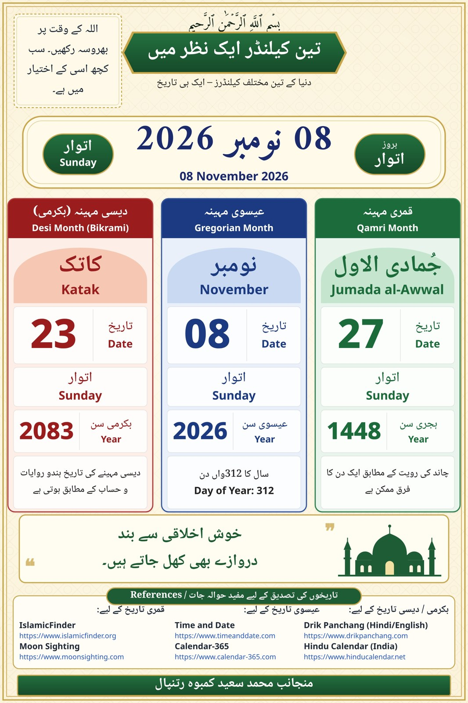
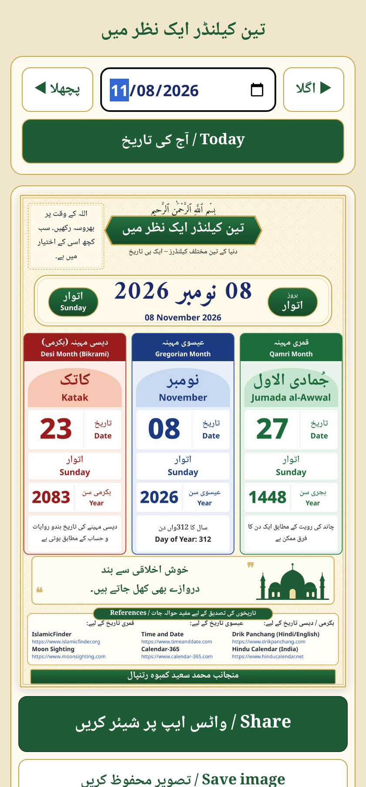

# تین کیلنڈر ایک نظر میں — Three Calendars at a Glance

A small offline web app that makes a daily WhatsApp-status image showing the same day in **three calendars**: Gregorian, Hijri (Islamic) and Desi (Punjabi Bikrami). It also adds an Urdu quote of the day.

I built it for my father. He used to put this image together by hand every morning. Now he opens the app, it fills in today's dates, and he shares the picture in one tap.

<p align="center">
  
  &nbsp;&nbsp;
  
</p>

**Live app:** _GitHub Pages link goes here once deployed_

## Features

- **Fills in today automatically.** He can also pick any date, or step one day back or forward, and all three calendars update.
- **Gregorian:** date, weekday in Urdu and English, and day of the year.
- **Hijri:** uses the Umm al-Qura calendar, with an adjustable **moon-sighting offset**. In Pakistan the month usually starts a day after Saudi Arabia, so the default is −1.
- **Desi (Bikrami):** calculated from the Sun's position against the stars, not from a hard-coded table, so it works for any year.
- **Urdu quote of the day:** a different quote each day from 107 short sayings, and he can step to another one.
- **Matches the original design:** the image follows the layout he was already posting, drawn on a 2132 × 3200 px canvas.
- **Works fully offline:** fonts and data are built into a single HTML file, with no server and no network calls.
- **Share to WhatsApp:** the Web Share API opens Android's share sheet. If sharing isn't available it falls back to downloading the image.
- **Settings are remembered on the phone:** name, top message and Hijri offset.

## How the calendars are calculated

### Desi / Bikrami (solar)

Each Desi month starts at a *sankranti*, the moment the Sun enters the next sidereal zodiac sign.

1. Compute the Sun's tropical longitude with the low-precision solar formula from Jean Meeus, *Astronomical Algorithms* (ch. 25). It's accurate to about 0.01°.
2. Subtract the **Lahiri ayanamsa** (23.857° at J2000, drifting about 50.3″ per year) to get the sidereal longitude.
3. `floor(longitude / 30)` gives the sign, which maps to the month: Mesha = Vaisakh, … Meena = Chet.
4. If the sankranti happens before midnight (IST), that same day is day 1 of the new month. The app walks back day by day to count the day of the month.
5. The Bikrami year is the Gregorian year + 57 from 1 Chet (mid-March), and + 56 before that.

The results are checked against well-known dates: Vaisakhi (1 Vaisakh, 14 April), Maghi (1 Magh, 14 January), Lohri (the last day of Poh), and my father's hand-made poster for 8 November 2026 (23 Katak 2083).

### Hijri (lunar)

The app uses the browser's built-in `Intl.DateTimeFormat` with the `islamic-umalqura` calendar, plus the user's ± day offset. If a browser doesn't support Umm al-Qura, it falls back to the arithmetic (tabular) Islamic calendar.

## Project structure

```
src/
  index.html              page markup (build placeholders for CSS/JS)
  styles.css              app screen styles
  js/
    main.js               app screen: date picker, preview, settings, events
    share.js              Web Share / download / fallback
    settings.js           settings + localStorage
    quotes.js             quote-of-the-day selection
    calendars/
      desi.js             solar longitude, ayanamsa, Desi date
      hijri.js            Umm al-Qura via Intl + arithmetic fallback
      names.js            Urdu/English month and weekday names
      index.js            datesFor(): everything for one date
    poster/
      poster.js           draws each section of the poster
      painter.js          canvas helpers (RTL text, fitting, wrapping)
      theme.js            colours and fonts
      mosque.js           mosque silhouette
  data/quotes.json        Urdu quotes
  fonts/                  Noto Naskh Arabic, Amiri, Amiri Quran, Noto Sans (OFL)
scripts/build.mjs         bundles JS (esbuild) and inlines CSS + fonts → dist/index.html
test/                     node:test unit tests for the calendars and data
.github/workflows/        test, build and deploy to GitHub Pages
```

## Running it

You need Node.js 20 or later.

```bash
npm install      # installs esbuild (the only dependency)
npm test         # runs the calendar tests
npm run build    # writes dist/index.html
```

`dist/index.html` is a single self-contained file, so you can open it directly in a browser.

Every push to `main` runs the tests, builds the app and deploys it to GitHub Pages.

## Technical notes

- **Right-to-left text on canvas:** each line is drawn with `ctx.direction = 'rtl'` or `'ltr'` as needed, so mixed Urdu and English lines like `سال کا 312واں دن` come out in the right order.
- **Text fitting:** month names, quotes and the footer shrink to fit their boxes, and long quotes are split into two balanced lines, breaking at the Urdu comma (`،`) when there is one.
- **Fonts:** fonts are embedded as base64 `@font-face` rules with `unicode-range`, and the app waits on `document.fonts.load()` before drawing, so the first image never uses fallback fonts.
- **Responsive loading:** drawing is synchronous, so each redraw is scheduled after a `requestAnimationFrame`. That lets the loading spinner appear first. A sequence counter throws away results from a redraw that has been replaced, for example when the date is tapped quickly several times.

## Roadmap

- [ ] Android APK (WebView wrapper) built automatically with GitHub Actions
- [ ] Daily reminder notification
- [ ] Prayer times for the user's city

## Credits

- Fonts: [Noto Naskh Arabic](https://fonts.google.com/noto/specimen/Noto+Naskh+Arabic), [Noto Sans](https://fonts.google.com/noto/specimen/Noto+Sans), [Amiri and Amiri Quran](https://github.com/aliftype/amiri), all under the SIL Open Font License (see `src/fonts/OFL.txt`).
- Solar position formula: Jean Meeus, *Astronomical Algorithms*, 2nd ed.
- Built with help from an AI coding assistant (Claude). I designed the requirements, tested it with my father and maintain it.

## License

MIT for the code. Fonts keep their own OFL licence.
